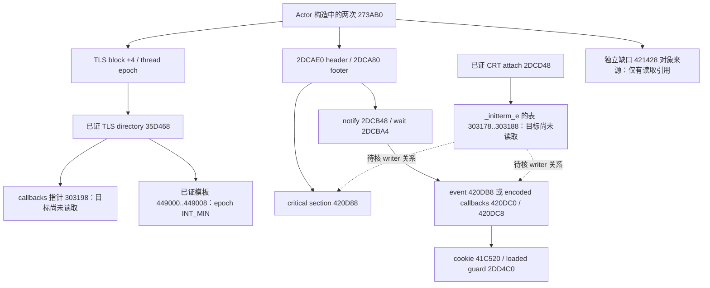

# Actor 初始化来源：依赖与有界取证计划

本段从已封存的 matrix-initialization 检查点继续。原版只读，不运行原游戏、Rea、Java 或同步 API；自有构建测试单独经正式审批，不修改执行策略、ACL，不接触存档或 commit/push。

实线表示已证引用关系，虚线只是本段待核查关系，不代表已经找到 writer。

| 优先级 | 已证入口 | 本段最小动作 | 停止条件 |
| --- | --- | --- | --- |
| P1 | TLS directory 的 AddressOfCallbacks=180303198 | 每次只读8B，最多8槽/64B，遇零停止；只记录目标 | 无零终止时保留有界前缀，不自动扩表 |
| P1 | 2DCDD0/2DCDD7/2DCDDE 为 `_initterm_e` 提供 303178..303188 | 固定读取16B，不追相邻 C++ initializer 表 | 表值不是已证有效模块内入口时不猜测目标 |
| P2 | 上述表明确给出的非零入口 | 先查已有归档；缺失时 exact `.pdata` 边界才允许正文读取；每函数≤4096B，单批总额≤8192B | 无 exact entry 不读取邻域或猜测前缀 |
| P3 | 已读函数的直接调用、导入和固定数据引用 | 仅继续闭合同步对象/编码回调 writer、TLS初始化相关的必要引用；每批另列固定目标与预算 | 需要运行时导出解析、实际线程/句柄/回调有效性时保留合同或停点 |
| 条件分支 | 421428 的已有 Engine 读取引用 | 只有归档出现明确 writer 入口才跟随 | 不以全引擎扫描寻找潜在写者 |

已有矩阵写序、cold/warm状态模型不重复实现或重跑作进度。新代码仅承接新证据能支持的初始化结果；文件零填充不能用作有效同步对象或全局对象。最终报告分别列出可由自有初始化建立的状态、仍依赖外部正常行为的条件和未验证的真实线程同步。

## 第一批结果与下一固定目标

`offline-actor-initialization-tables/metadata.json`（SHA256 `71d060530810ccd8e1c788f53b7d6e892d779bc85aa7614a6da4108ddf3a8eba`）记录实际读取24 B：init_e两槽分别为0和`1802DC908`；TLS callback首槽为0并立即停止。源文件前后SHA一致。此处只排除已存文件表中的TLS回调，不声称加载后指针不可变或Windows loader/TLS路径已验。

下一固定目标为init_e表提供的`2DC908`。先查归档；缺失时以`.pdata`二分查找核对exact start，单函数正文≤4096 B，最多一次已有dumpbin。只提取该函数，不自动跟随调用。421428仍没有直接writer入口，保持停止。

实际复用成功归档`offline-engine-root-static-helper-entry-prefixes/inspection.json`中原始entry11167：`08c92d0026ca2d00e8283600`，确定`2DC908..2DCA26`的286 B；没有重读`.pdata`。正文提供同步writer后，第三批仅核对三处直接IAT及四个直接字符串操作数。结果是`GetModuleHandleW(L"kernel32.dll")`，依次查询`InitializeConditionVariable`、`SleepConditionVariableCS`、`WakeAllConditionVariable`，缺任一时调用`CreateEventW(0,1,0,0)`。新增导入元数据75 B、字符串104 B。

第四批限定为`2DC926 → 2DDB20`的6 B导入跳板候选：仅在`FF25`及RIP目标吻合`3026F8`时继续读取对应OFT0和精确hint/name；不把6 B跳板视为VCRUNTIME函数正文。`2DCA28`只作为退出回调注册，此初始化段未调用它；`2DD7F4(7)`及后继INT3保留故障边界。cookie的运行时writer和同步API的内部效果也不在本段推断。

自有最小实现限定为`2DC908`调用顺序及三个槽的写入模型。新fixture测试该writer，不重跑既有matrix/constructor suite；因为正常初始化调用返回、甚至initializer返回0，都不证明同步对象有效，不自动放宽既有矩阵模型的真实同步前提。
