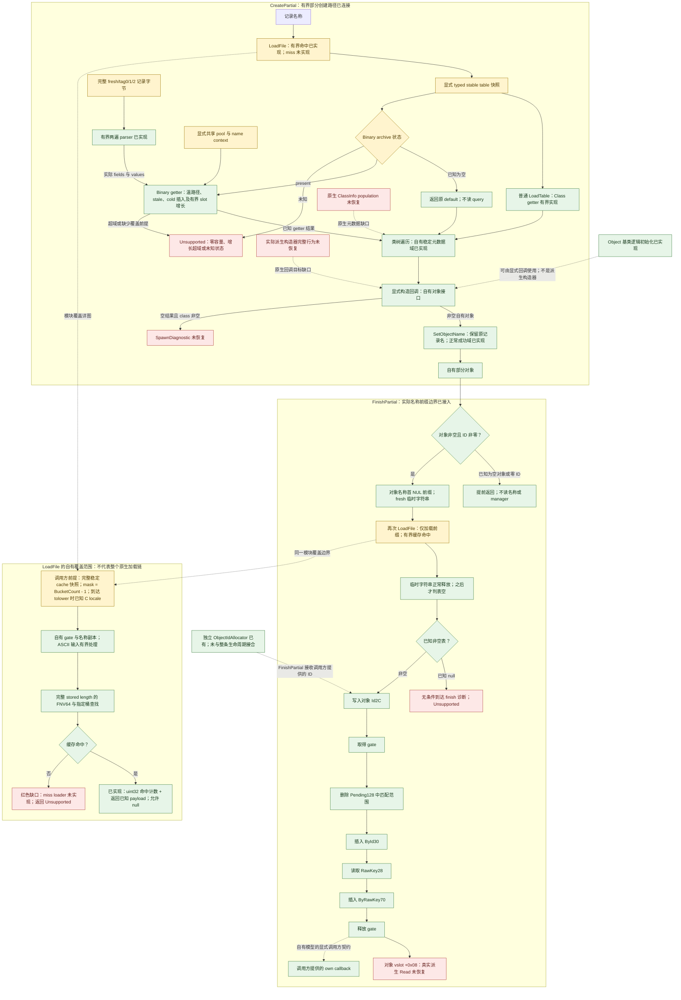

# 对象生命周期进度

最新检查点：[类注册追查与 Item 局部初始化](CLASS-REGISTRATION-AND-ITEM-SCALARS-RESULT.md)。新增 Item 323714..323743 六次标量写入段，18 条新断言通过；fresh 相关回归共 2282 条断言 / 83 组场景通过。具体类 getter 仅返回静态 ClassInfo，已读虚表槽呈清理形态；name/children 写入者、根注册及官方 Class 实际工厂分派仍未恢复，未生成猜测注册图或完整对象。首次 CS1513 编译失败已修复，失败记录保留，成功在独立 retry1 目录。未重读官方 ARZ；正式兼容、计时全局、一般归档生命周期继续未验。

以下保留历史阶段记录；当前注册与局部构造覆盖以上述结果为准。

最新证据检查点：[QuestItem 工厂与 Read](QUESTITEM-FACTORY-READ-RESULT.md)。已确认工厂、具体构造后缀、最终虚表 Read、五个派生读取键及七个导入；4 段共 1679 字节 / 394 指令。完整官方物品对象闭环仍阻于运行时类注册、Item/Actor 构造和 Actor::Load、图形资源服务及读取状态合同。本轮没有产品代码变更、新产品测试或官方 ARZ 读取；此前 2264 / 83 与单记录 123 断言仅保留为前次通过记录。原 Game 哈希保持，未启动原游戏/Rea/Java、安装扩权、接触存档/云或 commit/push。

以下保留历史结果；完整物品构造/Read 的当前状态以上述证据检查点为准。

最新检查点：[初始化与完整原 ID 缓存链](NATIVE-INITIALIZATION-CACHE-RESULT.md)。相关自有回归 2264 条断言 / 83 组场景通过；单条正式 scrapmetal 自有完整池链路另有 123 条断言通过，82,999 项原 ID 保持，首加载、Class getter、重复与关闭来源后命中均已验。正常 fresh 初始化前提有静态依据；显式自有时钟不代表四个原生计时全局初始化已恢复。完整原生兼容、工厂/注册、非 fresh 合并生命周期仍未验。原版哈希不变，无原游戏/Rea/Java、存档/云、安装扩权或 commit/push。

以下保留历史阶段记录；其中已闭合的旧阻断以上述新结果为准。

最新预检：[官方单记录缓存链停点](OFFICIAL-CACHE-CHAIN-PREFLIGHT-RESULT.md)。真实82999项池全字节唯一，空串原ID82687，最大259 B；原档前后哈希一致。检查器47/8独立自检通过，产品1971/57与官方38字段parser结果未重跑。源/完整池预算和archive/depot初始化、转换后tick仍阻止官方缓存首发；重复命中、关闭源后命中及新官方失败测试未执行。未填空上下文或伪造时钟，生产源码与限制不变。预检显式数组/缓冲4.81 MiB，Node maxRSS50.12 MiB，不是缓存链峰值。

以下保留历史检查点，不能把此前独立parser成功解释为本次官方缓存链通过。

最新检查点：[tag3 与官方废铁记录解析](BINARY-BOOLEAN-PARSER-RESULT.md)。自有回归 1971 断言 / 57 场景组通过；同一官方 scrapmetal 的 38 字段已由更新后的 parser 解析并逐项对照，7 个布尔位为 0x30。保留原 ID，不提供或重编号字符串池；完整多归档初始化、getter/factory 及原生分配/EH 仍未验证。16/17、32/33 字段的 log 舍入边界明确拒绝，非全部字段数兼容。全库预算未变，无原游戏/Rea/Java、存档/云、安装扩权或 commit/push。

以下保留历史检查点，其中旧覆盖范围及限制对应当时阶段。

最新实际数据检查点：[本机官方 ARZ 单记录检验](OFFICIAL-RECORD-PROBE-RESULT.md)。本机 database.arz（58,529,720 B，v3，82,999字符串）已实际只读验证。scrapmetal 单条323 B→456 B，两自有decoder逐字节一致；现有parser实际在第5字段tag3拒绝，游标0。完整source池预算也实际拒绝；38字段超15覆盖域是另一个明确缺口。独立wire观察不计作native parser兼容；未提高生产预算、未新增合成断言/重跑全套。原归档前后哈希相同；无原游戏/Rea/Java、存档云、安装扩权或commit/push。

以下保留历史检查点；此前“正式样本未读”描述仅适用于各自当时的阶段。

最新检查点：[归档字符串映射生成结果](ARCHIVE-STRING-MAP-RESULT.md)。自动生成去重池、追加 mapping/base，并绑定实际来源池接入重映射加载链。三个自有物理 ARZ 验证同串异 ID、重复项及顺序；首次回归 **1847 条断言、52 组场景、Demo 与 PEReader 通过**（新增122/6）。初始重复 ID 的加载拒绝、原生构造/指针缓存/offset 选择器与 allocator/EH 缺口明确保留；正式样本兼容未验。9次定点 dumpbin 共3326字节/895指令，原版哈希不变；无原游戏/Rea/Java、安装扩权、存档云访问或commit/push。

以下为历史检查点，按各自记录时间理解。

最新检查点：[记录体字符串重映射验收](RECORD-REMAP-RESULT.md)。280870已完成231字节/65条指令定点补证，无新helper；有界原地接口按字段类型处理key和字符串值，保留回绕、范围外相加结果及已写前缀。显式映射与目标池接入自有ARZ读取/解析/缓存链，旧重载不自动remap。

最终 **1725条断言、46组场景、Demo与PEReader通过**（新增82/5）；首次新增测试参数类型编译失败已保留，修正后完整重跑一次通过。两份不同字符串池/重复字符串合成ARZ、越界ID和部分写入均验证。未恢复原生映射生成、归档合并初始化、scratch生命周期及完整factory；未读官方样本，不宣称官方兼容。原版哈希不变；未运行原游戏/Rea/Java，未安装扩权、访问存档云或commit/push。

以下保留历史检查点，结论按其记录时间理解。

最新检查点：[输出长度解码器验收](NATIVE-DECODER-RESULT.md)。先评估136字节入口，再沿已见分支补齐500字节及32字节复制表，确认278D20的LZ4 fast类输出长度语义。新增显式安全profile，保留旧输入长度decoder；真实自有ARZ经parser和缓存接合，一次回归 **1643条断言、41组场景、Demo及PEReader通过**，新增94/4。

成功返回输入消耗量、允许尾随输入；安全guard的Unsupported与原生长度负返回分开，未复制原生越界内存及失败写入。未读取官方样本或声称兼容。回归完成后仅评估已有280870记录，缺少函数体，remap/初始化/factory等仍未闭合。原版/副本哈希一致；未启动原游戏/Rea/Java、未安装扩权、未触存档云、未commit/push。

以下保留历史检查点，按各自记录时点理解。

最新检查点：[有界只读 ARZ 接合验收](ARCHIVE-READ-RESULT.md)。真实自有 ARZ 文件经 raw LZ4 → 原始字符串池/body → mixed parser → 同一 Table 与缓存发布；关闭来源后普通命中通过。一次构建通过 **1549 条断言、37 组场景及 Demo**，新增149/6，PEReader检查通过。

本轮自有 fixture 通过不代表官方或原生兼容。官方样本规模仅引用旧报告元数据；记录指向的本机项目路径未找到，未推断删除。固定 dumpbin 六次共800字节，原版/副本哈希一致；278D20 decoder、280870 remap、native初始化/factory/Read仍未闭合。未启动Rea/Java/原游戏、未访问存档云、未安装扩权、未commit/push。

以下保留历史检查点，按各自记录时点理解。

更新日期：2026-10-20。本页汇总当前检查点；旧报告中的缺口描述只适用于各自当时的检查点，不能直接作为当前状态。

最新检查点：[有界 supplied LoadFile miss 接合与验收](SUPPLIED-LOADFILE-RESULT.md)。复用既有静态证据，将真实 mixed parser、同一 Table、fresh 名称复制/移动、节点构造、caller count/邻链写入及索引发布接入同一 depot。成功后普通 LoadFile 可命中新缓存；部分停止保留图和副作用，并阻止旧缓存被当作可用状态。

一次串行回归 **1400 条断言、31 组场景及 Demo** 全通过（新增140/4），PEReader元数据检查通过。实际 archive 取数、完整 native ctor/factory/Read、时钟转换与 EH 仍未恢复；只有明确供应已核验 bytes/context/转换后tick的有界分支可成功，普通缺数据 miss 仍明确拒绝。本轮未读原版或副本、未启动 Rea/Java/dumpbin；上轮原版哈希4c2ea14c…a93153证据保留，无安装、提权、存档访问、commit/push。

以下为历史检查点，按各自时点理解。

先前检查点：[离线节点构造与验收](OFFLINE-CACHE-NODE-RESULT.md)。使用已有 dumpbin 静态取得01F170、022860及已知caller共289字节，逐字节交叉核对，并定点绑定memmove导入。独立节点构造的正常成功域已实现：短串复制、堆存储身份转移、源重置及Table复制；不隐式挂链或增加count。

行为回归1260条断言、27组场景及Demo通过（新增51/2）。原wrapper在测试后的ReflectionOnly元数据步骤失败，记录保留；只读PEReader补检通过，未重跑测试。Rea/Java未启动，节点查询继续暂停，监控故障根因未知。完整LoadFile miss、原生allocator/EH及完整工厂仍未完成。原版哈希保持4c2ea14c…a93153，无安装、提权、存档访问、commit/push。

以下为历史检查点，按各自时点理解。

先前监控诊断检查点：[监控失败诊断与受控验证](MONITOR-DIAGNOSTIC-RESULT.md)。新增 PID/同 handle 创建身份、Win32 错误码和失败步骤的白名单记录，保持原有 fail-closed 条件。Native 诊断 296 条、既有 Job 回归 115 条、投影测试 30 条、controller mock 79 项及不释放 Rea 门的真实采样器集成均通过。

原 QFPI 故障没有复现，根因仍未知；仅完成诊断增强，节点查询继续暂停、未重试。07:05:20 UTC 核查分析进程与 Rea runtime 文件为 0。本阶段无 Rea/Java 启动或原版读取；缓存索引实现验收仍为1209条断言、25组场景及Demo，节点创建与完整LoadFile miss仍未完成。

以下保留先前阶段记录，以各自时点为准。

先前缓存索引检查点：[缓存索引发布实现与验收](CACHE-INDEX-PUBLICATION-RESULT.md)。一次 6.433 秒串行回归通过 **1209 条断言、25 组场景及 ItemQuestDemo**，新增 98 条断言、4 组场景。显式已挂链候选的查重、移除、索引发布及有界单层扩桶已实现；部分修改后的 Unsupported 保留累计副作用和首次停点，重复调用不会重做。节点创建、完整缓存发布及 LoadFile miss 仍未完成。

维护固定批次 02EA80/02EB40 **11/11** 完成且正常关闭，54 个记录身份退出。节点批次 01F170/022860 发出 4 次、完成 3 次，因采样器 QueryFullProcessImageName 异常失败，无函数 body；事后 22 个记录身份退出，分析进程和 runtime 文件均为 0。根因因缺 PID/Win32 错误码仍未确定，未修复或重试，节点查询保持暂停；7 个保护文件未改，Engine 前后哈希一致。

以下保留先前检查点，以各自时点为准。

先前缓存前缀检查点：[缓存索引前缀已实现并验收](CACHE-PUBLICATION-PREFIX-RESULT.md)。新69条断言、3组场景；一次5.857秒串行回归共 **1111条断言、21组场景，另有ItemQuestDemo通过**。显式已挂链入口的逆向查重、唯一键重链和端点更新已恢复；在02EB40/02EA80前保留状态并返回Unsupported，原生返回节点/inserted均未知，完整缓存发布及LoadFile miss仍未完成。

固定05DEB0/02E770查询 **11/11** 已通过并正常关闭；06:19:02 UTC复核66个记录进程身份全退、Java/临时运行文件0，Engine哈希不变。两份后续固定11-call计划（维护02EA80/02EB40、节点01F170/022860）分别保存，均未注册或执行，不能自动追踪。

以下保留此前检查点，均以各自时点为准。

此前混合解析检查点：[混合 tag0/1/2 parser 已实现并验收](BINARY-MIXED-PARSER-RESULT.md)。三组原始 word 与各自 offset 由真实字节解析生成，跨类型重复键按统一索引前插；新增43条断言、2场景。一次5.817秒串行轻量回归共 **1042条断言、18场景，加ItemQuestDemo通过**。完整LoadFile/工厂/Read依赖已核对，仍保留Unsupported，没有以成功占位接链。

缓存发布下一固定计划为05DEB0/02E770各三项分析，共11calls。已离线核验，当前封存时未注册/未启动；OW窗口随后已明确归还，实际执行仍需实时资源与逐次批准。混合实现阶段没有Rea/Java或原版读取。

以下保留此前检查点，均以各自时点为准。

此前tag2检查点：[Binary parser 有界实现已验收](BINARY-PARSER-RESULT.md)。已从实际 fresh/tag2 记录字节生成 getter 使用的 fields/values；新增 69 条断言、2 个实际解析到 Class getter 场景。相关模块 979 条断言及 16 场景和 ItemQuestDemo 通过，独立 Object ID 补跑 20 条通过，总计 **999/16 + ItemQuestDemo**。首次包装脚本在模块全部通过后遇到 Object ID 测试路径错误，原日志保留，不能把该次包装命令写成 exit 0。

必要 helper 两批 11/11 与 7/7 均完成并释放；最后释放时间为 2026-10-20T05:47:32.1182412Z。后续无 Rea 查询或重负载编译；最终 Java/decompile 为零、runtime 文件为零、Engine 哈希不变。完整 LoadFile miss、archive/name population、原生基类初始化及具体构造/Read 仍未闭合；其他 tag/field-count/坏输入不宣称等价覆盖。

以下是此前检查点的历史记录，其中“尚未实现/未重跑”等状态以各自记录时点为准。

此前查询检查点：[parser固定查询已完成](BINARY-PARSER-QUERY-RESULT.md)。专用Job与启动门控修复后，最终8/8调用通过，parser伪代码/汇编/直接callee已保存，正常MCP关闭、Rea退出0、Job为空均确认。68个记录进程身份已全部退出，runtime文件0，原版哈希不变。76项纯Node测试、115条真实Windows断言及门控联测通过；本轮没有新增行为实现或重新运行930/14历史行为验收。

[首次失败](BINARY-PARSER-ATTEMPT-RESULT.md)与[第一次重试失败](rea-binary-parser-entry-retry-1/summary.json)均保留独立证据。前者暴露短命父链/辅助Java归属边界，后者暴露退出时image查询竞态；修复过程及实际分支测试见[守卫验证](GUARD-REPAIR-VALIDATION.md)。下一工作是审阅已保存parser正文并确定最小解析域，不再需要重跑同一正文查询。

此前[384M实测与子对象查询](BINARY-SUBOBJECT-RESULT.md)已完成：固定8/8 calls通过，耗时103.332秒，实际Java为`-Xmx384M`。70个归属样本测得后端树private扫描峰值0.936GiB；含控制器/采样器为1.109GiB，WS为1.226GiB。进程均已退出、runtime为空、Engine哈希不变；重窗口已释放。[预算审计](MEMORY-BUDGET-AUDIT.md)将实测量、工程余量与系统保留量分开，其2.25GiB任务额度加2GiB系统保留的提案现已用于上述parser专用守卫。

`0481F0`在caller的RDX=0条件下只向parent`+78/+80/+88`写qword零，不读取R8指向内容，也不进入其他callee。结合构造器和槽值，已证明正常构造返回路径中`1C4FF4 → 0x18013F510`的实际调用边。该历史检查点当时未取得parser本体；现已取得正文但尚未据此实现，基类`13C1D0`初始化仍未闭合。行为代码未变，没有新增空记录/假成功路径，930/14仍是已有验收，本轮未重跑。82项基线中81项不变，唯一预期变化为Rea runner增加profile模式。

此前[构造器后的离线计划](POST-CONSTRUCTOR-NEXT-BOUNDARY.md)是槽读取及helper执行前的历史检查点，其中“未读/未注册/未执行”已由上述结果更新。基类ctor仍是后续初始化边界，已绑定的parser目标为`13F510`；正文现已取得，协议仍待逐项审阅。后续实现目标仍为由已证记录字节生成实际getter可读状态。

最新[构造器查询](BINARY-CONSTRUCTOR-RESULT.md)已在重负载窗口释放后完成 **8/8 calls** 并关闭：`0x18013F300` 确认写入 vptr `0x180341FE0`、保存 archive 至 `+0xC8`、正常返回原 this；基类构造 `13C1D0` 与 `+78` 初始化 helper `0481F0` 仍需闭合。下一处具体证据是槽地址 `0x180341FE8` 的8字节值，再绑定实际 parser；本次未读取该槽或扩查 callees。最低采样空闲12.523 GiB，释放复核13.490 GiB，Rea/Java均退出、runtime为空。行为代码未变，930/14仍是下述已有验收，本轮未重跑测试。此前[离线缺口梳理](POST-GROWTH-NEXT-BOUNDARY.md)中的“仅计划/暂停”是历史状态，当前以本次结果为准。

最新接合为 [Binary slot 增长结果](BINARY-GROWTH-RESULT.md)及 [精确证据](BINARY-GROWTH-EVIDENCE.md)：`0x180284200` 已完成 8-call 查询并正常关闭，源码已实现完整有效缓存满容量、oldCapacity>0、翻倍后≤4096 的正常迁移域。原温路径、stale 更新及 cold 插入继续保留；本轮不是 rehash。三个直接 callee 仅按伪码名称及正常成功外部契约使用，未独立查询 body 或绑定 IAT，native allocator/EH 不在覆盖内。历史 cold 报告中“284200 未知/待查询”只描述当时状态。

当前已有多个可独立编译、经过测试并连接的自有模块，完整原生物品工厂和记录加载链仍未闭合。本轮 `.tooling/binary-growth-build/` 一次 fresh build 通过，合计 **930 条断言、14 个组合场景及既有 ItemQuestDemo**；新增 BinaryPointerGrowth 36 条、2 场景，原894回归全部重跑，其中cold仅3条断言随新增长成功域调整预期。见 [最新验收](binary-growth-validation/acceptance-binary-growth.json)，检查点名称为 `binary-growth-passed`。上一 [894/12 cold 验收](binary-cold-validation/acceptance-binary-cold.json)保留为历史记录；这些均不是旧机完整离线894/16的重新通过。

**本轮接合：** cold 插入遇满缓存时，在有界正常域内先将旧 capacity 个 slot 迁移到新存储，以相同 slot index 迁移 next 和桶头，保留桶数、shift、mask、链顺序和 used count，再执行原插入。自有旧 entry 引用不再代表新存储中的节点；地址与 CachedId 值保持。`CacheStorageGrown` 与前后容量向 getter/CreatePartial 传播，后续失败保留已完成增长和插入效果。零容量、翻倍超预算或无效 metadata 仍 Unsupported。实现阶段没有新增后端查询或原游戏读取；前置查询另行记录，未扩展 parser、原生构造/Read 或自动生命周期。

## 已观察的完整调用链与实现边界

下图描述已观察到的调用关系和已连接的自有覆盖路径。绿色表示已有实现覆盖明确域，黄色表示显式输入前提或已有静态结构，红色表示影响完整原生成功链的未闭合行为。颜色不表示已构造原生对象；构造和 Read 的 own callback 都是调用方契约，不是恢复后的原生构造器或真实 Read。

CreatePartial 已保留已知空表的提前返回。getter 返回空 C 字符串仍先进入类工厂；已知空构造结果只有在 class 首字节非零时到达未恢复的诊断。FinishPartial 不同：已知 null 表无论名称是否为空都到达诊断，不能省略为成功返回；此前缓存命中计数仍保留。图中未知 ID、未知加载结果及超域路径各自返回 Unsupported，不冒充已知 guard 或表空。原生异常、回滚和并发可见性不因成功链已画出而成为已恢复行为；FinishPartial 的 ID 写入仍发生在加锁前，最终对象虚调用仍发生在解锁后。

## 逐环事实表

| 环节 | 已有证据与自有实现 | 当前缺口或覆盖边界 |
| --- | --- | --- |
| CreatePartial `Engine 0x18017E170` | `CreatePartialObject` 已按完整 caller 顺序连接有界 LoadFile 命中、typed Class getter、已有类树分派/显式构造回调及原记录名的 SetObjectName；40 个断言、2 个场景通过。保留空表返回、空 class 仍分派、已构造对象和已完成副作用。 | 回调返回非空对象后才赋名；空构造结果且 class 非空时在 `SpawnDiagnostic` 返回 Unsupported。不补造原生 ClassInfo、派生构造、冷加载、ID 分配/注册或真实 Read。 |
| ClassInfo 与类树分派 `Engine 0x180274EC0` | 自有 `ClassFactoryDispatch` 实现原始 NUL 字节比较、自身优先、子数组顺序、首个非空结果；匹配节点回调返回空时不搜索其子节点，父级可继续兄弟节点。 | 真实根 `0x18041CF00` 的 population、子项顺序、生命周期、工厂指针目标和 ABI 未恢复。自有输入元数据与 `Func<object>` 回调不是原生注册表或构造器身份。 |
| Object 基类构造 `Engine 0x18003A6B0` | 七条汇编、无 callee；自有实现初始化基类标识、名称容量 15、长度 0、首字节 NUL，保留 `RawKey28` 和 `Id2C` 未知或原值。 | 不代表原生分配、完整对象大小、padding、析构、派生构造或工厂选择；不能当作完整 Item。 |
| 派生 Item 构造 `Game 0x180323690` | 已有静态完整汇编，证明安装主 vtable `0x18076A4C0` 等写入，并调用多个 helper。 | 已有证据不应写成“完全未知”；但 helper、完整构造效果和工厂选择仍未闭合，没有据此实现完整派生构造。 |
| SetObjectName `Engine 0x18003A780`，helper `0x180023180/0x180022F70` | 自有正常成功域已实现：有效逻辑字节字符串、长度不超过 65536、独占访问；保留目标容量、精确增长比较、自别名跳过赋值后仍重算 key、按完整 stored length 做 signed-byte FNV32。先写名称，再写 `RawKey28`，不写 ID。 | 假定正常分配、复制、释放成功；泛型 substring/erase、损坏存储、原生指针布局、异常/OOM 不在覆盖内。预算拒绝在自有修改前；不宣称原生失败回滚。 |
| LoadFile `Engine 0x1801C4D20` | 自有 `RecordLoadFile` / `RecordCacheSnapshot` 的有界缓存命中路径已实现并通过 42 个 RecordCache 断言。保留名称副本、条件 C locale、ASCII 处理、FNV64、桶内首个命中、计数回绕、已知 null payload 和解锁后返回。CreatePartial 传完整原名；新 FinishPartial wrapper 传首 NUL 前缀。 | 调用方显式提供完整稳定快照及 `mask = BucketCount - 1`，不推断原生初始化。miss 后续加载、构造器、表读取、缓存插入 helper、所有权和原生异常仍未闭合。旧两个显式 full-name 第二次 LoadFile 组合场景只验证旧接口范围，不作为真实 FinishPartial 名称边界的证据。 |
| 普通 LoadTable `+0x28` getter，`Engine 0x18013C6B0` | 函数体和 `0x18013EBC0` lower_bound / `0x180022CE0` fresh-copy 路径已观察。`RecordTableGetter` 在完整稳定、有序唯一字段快照上实现精确查找；query 按首 NUL 截断，stored key 保持完整。未命中或 value stored length 为零返回同一 default；正长度但首字节 NUL 返回原 value 身份。新 getter suite 共 43 个断言通过。 | typed snapshot 由调用方明确提供，等价有效 BST 的查询结果，不保留树形/比较次数，不证明原生字段 population 或解析。最多 4096 字段、单字符串 65536 字节、key/value 总 2 MiB；未知/无效/超预算域不伪造已知 miss。 |
| LoadTableBinary `+0x28` getter，`Engine 0x18013FB60` | `0x180283840` / `0x18013FC80` 已连接温命中、stale 查找/写回、cold 插入及有界 slot 增长。stale/cold 先 fresh-copy、typed int32 lookup、正常释放，再对非 -1 ID 写回/插入，-1 仍继续 numeric。增长、count 和节点写副作用传播到 getter/CreatePartial。 | 同 gate 或独占访问、完整名称映射和有效池/buffer 是前提；cold 插入需要显式 count/capacity/slots。legacy 缺少插入 metadata 时，仅实际插入需求才 Unsupported。零容量/超预算增长、parser、native allocator/EH 和并发未恢复。 |
| Binary cold 插入 `Engine 0x180284160` | 有容量分支按 oldCount*24 选槽，原生写序为 count→地址→ID→next→桶头，没有 duplicate 检查。先前 cold suite 50 条、2 个全链场景已通过；本轮满缓存先经有界 `284200` 迁移，再继续此插入。 | 正常可写存储是明确前提，不声称原生中途异常等价；全链统计以最新验收为准。 |
| Binary slot 增长 `Engine 0x180284200` | 函数体已取得；分配参数24×newCapacity，清零参数仅8×newCapacity；复制旧capacity槽并按index迁移next/桶头，不rehash。自有正常域为 full>0且double≤4096，保留slot index、桶数/shift/mask和链顺序；新节点替代旧存储身份。新增36条断言、2个全链场景通过。 | 三callee `2DC900/2DDB14/2DC8F8` 仅按伪码命名与正常外部契约使用，未独立body/IAT绑定。零容量、缩容、溢出、无效指针、分配/free异常与中途可见性不在覆盖内。 |
| FinishPartial caller 与注册 `Engine 0x18017E230` | 新 `FinishPartialObject` 先执行 null-object/zero-ID guards，再从对象 name 取首 NUL 前缀、重新调用已有 LoadFile，并在临时字符串正常释放后分支；43 个断言、2 个场景通过。非空表进入 `LoadedObjectRegistration` 的 ID 写入、gate、pending 删除、双索引和解锁后 own Read；不重算 RawKey，不改原名称，保留既有副作用。 | 空表始终在未知诊断处 Unsupported；miss/未知加载结果不冒充空表。真实派生 Read、原生锁身份、异常 ABI、并发、分配/销毁全生命周期仍未完成。不得将旧显式完整名称重载场景当成本 caller 已实现的证据。 |
| 注册容器及增长 | 自有链表和桶端点实现匹配删除、重复键保留、插入顺序、精确 reserve 和单层 rehash；最多 65536 节点、4096 桶，单层后负载须满足条件。 | 有界正常分配/释放成功域；递归增长、原生地址寿命、CRT/free 实现及 OOM 未恢复。超域可发生在原插入之后，已完成前缀不能回滚或当作完整状态继续使用。 |
| ObjectIdAllocator | 已有独立分配器分支和回归测试；native allocator 的 manager+0x10 与 registration 的 manager+0x28 是不同锁边界，自有状态仍保持独立。 | 未将真实管理器索引、锁、分配、登记、销毁全链接合；ID 或提供的 descriptor 不等于原生对象。未接入 InventoryAdd 形成完整工厂。 |
| 对象 `+0x08` Read | FinishPartial 解锁后虚调用顺序已确认。Object 基类 vtable `0x180339F78 + 0x08` 指向 `0x18000CE70`，入口为 `RET 0`。 | 只证明该基类槽；派生构造可替换 vtable，真实派生 Read 的目标和记录读取效果未恢复。测试的 own callback 不作为真实 Read 证据。 |

## 已有 LoadFile 静态事实

以下结论来自 Rea 6.5.0 / Ghidra 12.1.4 的固定 Engine 批次，读取的是归档函数体，不是运行原版或从伪码直接恢复源代码。

| 函数与证据 | 观察事实 | 尚未据此恢复的行为 |
| --- | --- | --- |
| 名称处理 `0x18027B3C0`：[伪码](rea-record-load-dependencies/04-LoadFile-name-processing-0x18027b3c0-pseudocode.json)、[汇编](rea-record-load-dependencies/05-LoadFile-name-processing-0x18027b3c0-assembly.json) | 遍历完整 stored length。字节 `0x5C` 改为 `0x2F`；其他字节经 `MOVSX` 传给 IAT `0x180302BC8`，再写入返回值低字节。[固定 PE 导入读取](record-load-discovery/tolower-import.json) 确认为 `api-ms-win-crt-string-l1-1-0.dll!tolower`。循环索引经 32 位寄存器递增。嵌入 NUL 不终止。 | 原生 locale 初始化、调用时 locale 和高位字节效果未知；不能用当前 .NET culture 或 Unicode 大小写规则代替。 |
| 查找 `0x18003C8E0`：[伪码](rea-record-load-dependencies/07-LoadFile-lookup-0x18003c8e0-pseudocode.json)、[汇编](rea-record-load-dependencies/08-LoadFile-lookup-0x18003c8e0-assembly.json) | 对完整名称的 unsigned byte 做 FNV64：初值 `0xCBF29CE484222325`、乘数 `0x100000001B3`，与已存 mask 按位 AND 选桶。空桶返回 sentinel；非空桶从 first 沿 next 扫到 `last.Next`，不包含该终点。每个候选先比较最多较短长度的字节，再要求长度相等；候选命中后以反向参数再作一次长度/`memcmp` 判等。函数写出节点或 sentinel；LoadFile wrapper 命中后先 INC 32 位 `+0x54`，再读节点 `+0x30` 作为返回值。 | 缓存初始 population、mask、链/桶端点、节点 key/value 均不能凭空生成。`last.Next` 可能是下一桶首节点，不能改为一直扫描全局 sentinel。不能重新规范化已有缓存键。 |
| miss `0x1801C4E20`：[伪码](rea-record-load-dependencies/10-LoadFile-miss-0x1801c4e20-pseudocode.json)、[汇编](rea-record-load-dependencies/11-LoadFile-miss-0x1801c4e20-assembly.json)、[直接 callee](rea-record-load-dependencies/12-LoadFile-miss-0x1801c4e20-direct-callees.json) | 从 `gEngine +0x3D0` 取得 DatabaseArchive；先按名称查 ID，再通过 ID 索引取得数据地址/长度，或调用 `0x180280E20`。数据可用时分配 `0xD0`，调用 `0x18013F300`（LoadTableBinary 构造入口），再调用所返回表的 vslot `+0x08`。失败路径增加 depot `+0x58` 并诊断，再分配 `0x30`、调用 `0x18013C1D0`（LoadTable 构造入口）。两条正常返回路径汇合，使用 `0x18005DEB0` 和 `0x18002E770` 建立/维护缓存项，增加 `+0x50`，累计时长至 `+0x5C` 并更新最大时长 `+0x60`。 | 不是简单的“miss 返回 null”。上述数据库、构造、表读取、节点维护和资源释放依赖未全部闭合；不伪造加载结果、失败计数或缓存插入。这里的表 `+0x08` 调用与 FinishPartial 最后的对象 `+0x08` Read 是不同接收对象上的调用。 |

比较入口 `0x1802EE060` 的 [独立汇编](rea-record-cache-compare/05-Record-cache-compare-0x1802ee060-assembly.json) 只有 `JMP qword ptr [0x180302710]`；[固定 PE 导入读取](record-load-discovery/memcmp-import.json) 确认其为 `VCRUNTIME140.dll!memcmp`。这证明静态导入身份；自有模型采用有效可读缓冲区上的正常比较契约，不宣称恢复或执行 CRT 内部实现。

## 已实现的有界缓存命中域

`RecordLoadFile` 和 `RecordCacheSnapshot` 已实现以下条件域，并经统一 fresh build 和回归验证。前提由调用方明确提供，不是对原生运行时状态的推断：ASCII 输入字节（`0x00..0x7F`）、完整有效且稳定的缓存快照，以及正常字符串复制/释放和比较契约。**任何字节到达 `tolower` 分支时，必须有已知且稳定的 C locale**；空名称或全部由反斜杠组成的名称不调用该 import，因此不要求 locale。其余未知/非 C locale、高位输入字节和超出覆盖范围的输入返回 Unsupported。原生 cache 初始化与 miss loader 不在本实现范围内。

- 只处理输入名称副本；保留源名称及缓存键。名称转换、FNV64 和判等均按 stored length，必须保留嵌入 NUL 后的内容。ASCII 不是 NUL-terminated 文本假设。
- 快照按已知 next 顺序提供完整节点及 payload，桶段须连续，mask 明确为 `BucketCount - 1`。桶数是 1 到 4096 的二次幂，节点最多 4096，每个 key 最多 65536 字节，总 key payload 最多 1 MiB；构造检查拒绝无效或超预算快照。这些是自有覆盖限制，不是恢复出的原生初始化规则。
- 保留桶 first/last、遍历方向、`last.Next` 排除边界及第一命中 entry 身份。稳定可读存储下，原版两次相反参数方向的相等比较可归结为完整字节相等；不模拟原生比较调用次数、访问宽度、无效内存故障或并发变化。
- 每个 payload 必须由快照明确提供；已知 null 仍是命中。命中计数按 32 位回绕并保留已完成效果，不能把 null 改成 miss。输入名称和缓存 key 均不被修改。
- 拒绝超域输入不增加持久命中计数；操作仍可能已取得自有 gate 或创建局部副本。自有 `finally` 清理不代表原生异常回滚。miss 在未闭合 loader 前返回 `UnimplementedRecordCacheMissLoader`，不制造文件加载、诊断、fallback table、miss 计数或缓存写入。

## 已接合的 Class getter 与部分创建

[完整 getter 证据](CLASS-GETTER-EVIDENCE.md) 同时保留已完成的 11-call 与 17-call 批次，以及 CreatePartial 旧机同 SHA 伪码中的 `"Class"` / `""` 字面量来源和本机 caller 汇编顺序。普通 getter 的 lower_bound 按完整 stored key 做 unsigned-byte `memcmp` 和长度比较；caller 再以 query≥candidate 复核，在有效 BST 前提下确定精确相等。自有 complete sorted unique 快照复现这一结果，不声称恢复原生树节点布局。

- getter query 的 `Class\0suffix` 只查询 `Class`；表中 stored key `Class\0suffix` 不截断，因此不是同一键。原记录名的缓存和 SetName 仍按完整 stored length 处理，不能混成同一种字符串规则。
- value 的 stored length 为零才回退 default。正长度但 leading NUL 仍返回原 value；随后工厂看见空 C 字符串。内嵌 NUL 后缀保留在存储中，类名比较只消耗首个 NUL 前的内容。default、匹配字段和 value 的自有身份分别保留。
- 普通表必须显式提供 typed stable 完整字段快照；Binary 需要显式地址、完整 pointer/field 桶链、共享池和 buffer。stale/cold 另需 typed name→int32 映射；stale 写 CachedId，cold 写 count、slot 和桶头，满缓存的有界增长迁移slot并更新容量。已知 absent 不读取 query；未知数据或增长超域不伪造默认结果。
- `CreatePartialObject` 将普通 getter 接到已有类树分派、显式构造回调和 SetName 接口。工厂前不把空 class 过滤掉；非空构造结果才设置原记录名。若 callback 修改了原名称对象，后续赋名使用该对象的当前状态，不用预先复制的缓存规范化名称代替。回调副作用或已构造实例不会因后续 Unsupported 而被抹掉。
- 冷加载、表构造及解析、原生 ClassInfo population、实际派生构造、诊断虚调用和真实 Read 仍未闭合。这里没有增加绕过依赖的独立 Binary numeric getter、假定的 parsed record 或完整原生物品工厂。

## 已接合的 Binary 温路径、stale、cold 与 slot 增长

[温路径证据](BINARY-WARM-EVIDENCE.md) 映射 `0x18013FB60 → 0x180283840 → 0x18013FC80`，调用方提供显式地址、完整 pointer/field 桶链、同一字符串池和 buffer。缓存名称先按完整 64 位 CachedId 读取。内容相同直接进入 numeric；内容不同且有完整 typed 名称映射时，执行 [stale 路径](BINARY-STALE-EVIDENCE.md)：query 首 NUL 前缀 fresh-copy → unsigned-byte FNV64 lookup → 正常临时释放 → 非 -1 ID 符号扩展写回原节点 → numeric。

名称未找到或命中 -1 都不写旧缓存，却仍以完整符号扩展负键查 numeric。非 -1 的负 ID 也写回，本次不能提前查新 ID 的名称池有效性。后续再次读缓存名字才检查该次完整 64 位池下标。字段 miss/tag≠2 返回同一 default，合法 buffer 中的负/池外 string index 返回 Known null，空池项保留身份。getter 保留 CacheIdWritten/Changed 和前后值，CreatePartial 聚合副作用；后续 Unsupported 不回滚。

名称映射显式采用完整稳定桶段、power-of-two bucketCount 与原 mask=bucketCount−1 的有界域，最多 1 MiB key；预先检查总预算后才建立键副本。共享可变节点要求同一 table gate 或调用方独占，不能把只读快照时期的假设带入 stale 写回。manager+0x10 allocator 与 manager+0x28 registration 的锁仍分离，没有自动 Allocate→Create→Finish 接合。

温路径 2 场景继续验证 Create→Finish 前缀重载和双索引增长；此前 stale 2 场景验证真实 CreatePartial 的更新成功/未知 numeric 两种结果。本轮 [cold 实现](BINARY-COLD-EVIDENCE.md) 新增 2 个全链场景：已知名字 ID 在显式有容量槽中前插，继续真实 getter/CreatePartial/FinishPartial 接口；缺失 own Read 仍保留先前效果并 Unsupported，不称为 native Read。

六参数 pointer-cache 快照提供 usedCount、capacity 和完整 slot 数组；已用 slot 的唯一引用与桶节点一一对应，unused null cell 是已分配可写槽。helper 本身没有去重；正常 caller 先按地址搜索，同地址走 warm/stale，同字节不同地址可分别插入。名称 miss/-1 不消费槽，缺少插入 metadata 的 legacy 快照也可先完成查找/释放并以 -1 继续 numeric。`CacheCountWritten/CacheNodeInserted`、前后 count 与 slot index 向上层传播，后续失败不回滚。

`0x180284160` 的 [历史查询](BINARY-COLD-QUERY-RESULT.md)与本轮 `0x180284200` 的 [新查询](rea-binary-pointer-growth/summary.json)均已各完成 8 calls 并关闭。增长在 full>0、double≤4096 的正常域内实现：按旧capacity迁移全部槽，以相同index映射next/桶头，既有桶数组和链顺序保持，不重新分桶；准备自有表示后才发布。原生顺序是桶头先改、旧块后释放、slotBase/capacity最后写，不可承诺中途异常等价或回滚。三个callee的body/IAT身份未独立补证，没有自动启动下一查询。原生解析、派生构造、真实Read和自动分配/销毁链仍未实现。
## 已接合的 FinishPartial 名称边界

[FinishPartial 证据](FINISH-PARTIAL-EVIDENCE.md) 使用此前已保存的 `0x18017E230` 完整汇编，以及已经分析的 `0x180022CE0`、`0x180022F70`、`0x180023090` 正常复制/增长/释放域。此前接合没有新开分析后端；这是一处 caller 接合，不是绕过依赖新增独立模块。

- 空对象在任何名称/manager 读取前返回；非空对象的零 ID 同样先返回。未知 ID 不能当零。有效非零 ID 才选择对象 name 的 inline/heap 逻辑字节，并扫描首个 NUL。
- 临时字符串从容量 15 开始，只复制前缀；超过 15 字节时正常容量为 `prefixLength | 15`。原名称和容量不被缩短；原始名称 NUL 后的高位字节不进入此次 LoadFile 的 ASCII/locale 检查。
- CreatePartial 的第一次加载按完整 stored name，FinishPartial 的第二次加载按首 NUL 前缀，两次可能命中不同表。注册与 own Read 必须使用第二次实际返回的表；不能复用第一次表，也不能重算 RawKey28 为截断/规范化名称的 hash。
- 已知 null 表先完成正常临时释放，再无条件到达 `LoadFailureDiagnostic` 断点，保留已发生的 cache 命中计数；在当前自有实现停止点尚未写 ID 或调用注册。未恢复的诊断内部行为不作无副作用假设。miss/加载 Unsupported 则停在原加载阶段，不伪造成已知 null 或已执行诊断。
- 非空表接已有注册模型：ID 写入先于 manager gate，RawKey 在首次索引插入后读取，最终 own Read 在解锁后调用。缺失/抛错回调不会回滚已完成登记；own callback 仍不表示真实派生 Read 已恢复。

旧 20 断言、2 场景的组合 suite 保留其原有显式接口覆盖：第二次加载由测试直接提供完整名称。它并未实现 FinishPartial 的 C-string caller，不能被描述为已验证新的首 NUL 行为。新边界的验收以 [FinishPartial 结果](FINISH-PARTIAL-RESULT.md) 为准。

## 最新统一验收

本轮 fresh build **一次成功，6.5619772 秒**：17套模块测试、既有 ItemQuestDemo 与独立 ObjectId20 回归均通过，共930条断言。新增 BinaryPointerGrowth36条、2个全链场景，原894全部重跑（cold3条断言改为新增长成功预期）。见 [模块日志](binary-growth-validation/build-output.txt)、[ObjectId日志](binary-growth-validation/object-id-regression-output.txt)、[执行记录](binary-growth-validation/build-run.json)及 [验收清单](binary-growth-validation/acceptance-binary-growth.json)。[程序集依赖记录](binary-growth-validation/task-items-dependencies.json)确认只引用framework与自有模块，无Engine/Game/Steam依赖。

上一cold检查点的初始CS0136及ObjectId命令问题已当轮修正，绝对Windows路径指的是源码路径，编译器路径从一开始即为绝对路径；其 [attempt与执行记录](binary-cold-validation/build-run.json)、[历史模块日志](binary-cold-validation/build-output.txt)继续保留。该轮不是一次无误通过，不能与本轮的一次fresh build成功混写。

| 测试组 | 断言数 |
| --- | ---: |
| RegistrationIndex | 183 |
| RegistrationGrowth | 141 |
| LoadedObjectRegistration | 47 |
| ObjectBaseConstructor | 40 |
| ObjectNameAssignment | 37 |
| 原显式对象生命周期（2 场景） | 20 |
| RecordCache | 42 |
| RecordTableGetter | 43 |
| CreatePartial（2 场景） | 40 |
| FinishPartial（2 场景） | 43 |
| BinaryWarmGetter（2 场景） | 65 |
| BinaryStaleGetter（2 场景） | 33 |
| BinaryColdGetter（2 场景） | 50 |
| BinaryPointerGrowth（2 场景） | 36 |
| ClassFactoryDispatch | 40 |
| ItemCondition | 39 |
| ItemAuto | 11 |
| 独立 ObjectId 回归 | 20 |
| **总计** | **930** |

七套组合测试共 14 场景，另有 1 个既有 ItemQuestDemo。fixtures 的 typed table、metadata 和 own callbacks 都是明确前提，不证明原生 population、派生构造或真实 Read 已恢复；原显式生命周期 suite 仍只覆盖其完整名称接口。

**growth实现阶段新增Rea调用0**，前置 `284200` 查询 **8/8 calls 已完成并关闭**，耗时97.536秒，固定Engine前后哈希一致。最低采样空闲内存 **6.524 GiB**，host关闭复核为 **7.515 GiB**；Rea20744/Java21120均已消失，runtime为空，正常退出0，无强制终止，见 [新资源记录](rea-binary-pointer-growth/resource-release.json)。实际stdio MCP连接与分析已成功，当前Codex没有直接注入Rea工具不等于本机服务失败。以上是已完成查询的观测，不是未来峰值或内存预留保证。

本轮growth验收保存 **82项**源码/产物/工具哈希；[一致性检查](binary-growth-validation/consistency-check.json)对上一79项确认 **74项未变、5项预期变化**：BinaryColdGetterTests、BinaryWarmTable、build_items、RecordTableGetter及前置查询的Rea runner。MCP配置与UCRT门禁未变。上一cold的79项清单及其 [历史一致性检查](binary-cold-validation/consistency-check.json)保留，不用旧计数代替本轮结论。历史原版13文件哈希继续保留，没有重跑旧机完整离线894/16验收；`284200` 已查询并实现有界正常域，不再属于“尚未启动”的目标。
## 证据索引与不变约束

- [类树分派及 CreatePartial/FinishPartial caller 证据](NATIVE-REGISTRATION-EVIDENCE.md)。其未闭合列表是早期检查点；名称和注册容器应结合下列后续结果阅读。
- [基类构造、LoadFile wrapper 与槽位边界](OBJECT-BASE-EVIDENCE.md)，以及 [固定 PE 槽读](record-interface-discovery/record-interface-vslots.json)。其名称 helper 未分析的描述已由后续名称证据更新。
- [Item 构造器已有静态汇编](../rewards/rea-inventory-add/Item-constructor-primary-table-assembly.json)：Game SHA256 `cd7ecd7942d719f96b42aff4896f8c25d52152b4a41191f71a4a66ea48cecad2`。
- [名称赋值与增长证据](OBJECT-NAME-EVIDENCE.md)、[最新名称实现结果](OBJECT-NAME-RESULT.md)。
- [LoadFile 证据及外部契约](RECORD-LOAD-EVIDENCE.md)、[缓存命中实现结果](RECORD-LOAD-RESULT.md)、[直接依赖批次汇总](rea-record-load-dependencies/summary.json)、[比较入口批次汇总](rea-record-cache-compare/summary.json)。两批合计 22 calls，均已关闭。
- [Class getter 与 CreatePartial 证据](CLASS-GETTER-EVIDENCE.md)、[Class getter 实现结果](CLASS-GETTER-RESULT.md)、[getter 函数体批次](rea-record-class-getters/summary.json)、[四 helper 支持批次](rea-record-getter-support/summary.json)。此前两批合计 28 calls，均已关闭；更早报告中“两个 getter 未分析”的描述已由这些证据更新。
- [FinishPartial caller 证据](FINISH-PARTIAL-EVIDENCE.md) 与 [FinishPartial 接合结果](FINISH-PARTIAL-RESULT.md)。仅复用既有归档证据，没有追加 Rea/Ghidra 查询；真实首 NUL 边界取代将旧显式 full-name 重载场景视作完整 caller 的理解。
- [注册容器证据](REGISTRATION-CONTAINER-EVIDENCE.md)、[增长证据](REGISTRATION-GROWTH-EVIDENCE.md)、[增长实现结果](REGISTRATION-GROWTH-RESULT.md)。后者仍列出的“名称/key 未恢复”属于当时历史状态。
- [最新930断言验收](binary-growth-validation/acceptance-binary-growth.json)、[本轮增长证据](BINARY-GROWTH-EVIDENCE.md)、[增长结果](BINARY-GROWTH-RESULT.md)与 [查询汇总](rea-binary-pointer-growth/summary.json)。[894 cold检查点](binary-cold-validation/acceptance-binary-cold.json)、[cold结果](BINARY-COLD-RESULT.md)、[cold证据](BINARY-COLD-EVIDENCE.md)与 [前置查询](BINARY-COLD-QUERY-RESULT.md)，以及 [844 stale检查点](binary-stale-validation/acceptance-binary-stale.json)、[811 warm检查点](binary-warm-validation/acceptance-binary-warm.json)、[746 FinishPartial检查点](finish-partial-validation/acceptance-finish-partial.json)及其 [13文件原版哈希](finish-partial-validation/game-hashes-after.json)、此前703/620/558报告均作为历史记录保留。

本页 Engine 地址均以固定 SHA256 `4c2ea14ce1c591b315cc29a8a96819a5c3c7e194adbd6f7eea208b9bb8a93153` 为基准；明确标为 Game 的 Item 构造器使用上列 Game 哈希。原版只做静态分析，没有启动原游戏或加载 DLL 执行；没有读取玩家存档或 Steam 云数据。自有模型不兼容原存档，不承诺恢复原始源代码。没有据本页扩大工具、二进制、运行或安装权限。

2026-10-20 static registration investigation: [Item/QuestItem writer evidence and remaining gaps](CLASS-STATIC-INIT-RESULT.md). The bounded Game CRT initializer table has located Item slot 115 and QuestItem slot 205. This is static evidence, not proof of successful runtime registration or complete native item construction. Product sources remain unchanged; previous 2282 assertions / 83 scenario groups were not rerun. See the result document for exact store order and blockers.

2026-10-20 registration helpers: [bounded helper evidence and local Item/QuestItem model](CLASS-REGISTRATION-HELPERS-RESULT.md). The native allocation/release/exit-registration call chains are now identified. The own local writer model preserves duplicate appends and partial effects; external allocator/runtime behavior and the Engine root registry remain outside it. Only the new targeted tests ran; previous 2282 assertions / 83 scenario groups were not rerun. Formal sample compatibility remains unverified.

2026-10-21 Actor array dependency: [EBDE0(this+198,4) evidence, conditional composition and validation](ACTOR-CONSTRUCTOR-ARRAY-RESULT.md). The fixed request is 520 bytes with cookie 4 and four 128-byte elements. Each element has fourteen observed stores; default composition stops before the unresolved loaded guard. The explicitly named archived-file-initializer profile uses the proven CE70 `C2 0000` behavior and joins the base/Actor segments up to 25C55, with 130 Actor stores and 57 array stores. This is conditional own data projection, not complete native construction or permission to omit runtime checks. One separately approved build passed 64 new assertions / 11 groups; old suites were not rerun, while unchanged Actor prefix APIs were naturally exercised by new integration fixtures. Next direct evidence is Engine 025C5F → 022CE0. Original Engine hash remains pinned; no original game/Rea/Java, saves, security changes, commit or push. Checkpoint: `.tooling/checkpoints/actor-constructor-array-complete/manifest.json`.

2026-10-21 Actor continuation: [fixed empty assignment and contiguous construction prefix](ACTOR-CONSTRUCTOR-CONTINUATION-RESULT.md). Cached independent Engine 022CE0 evidence closes the fresh inline length-0/capacity-15/count-0 call without source payload reads or callees. The own continuation joins its two stores, eight scalar stores, one 16-byte MOVUPS and a flag store, then accepts only an explicit successful initial 856-byte allocation observation and stops before 025CC9 → BDBE0. It never publishes BDBE0's unproved return at +1E0. Only 16 new original data bytes at 34C3B0 were read, plus two full streaming Engine hash passes, both pinned. The archived constant and CE70 profile remain explicitly file-initial observations; the default loaded-guard stop is preserved. One separately approved exact build passed 47 new assertions / 8 groups; no old suites ran, but new fixtures naturally reuse the unchanged array/prefix models. Remaining full-normal dependencies include BDBE0's construction/return identity, 34BB44 and global 421428 state; loaded guard, failure/EH and formal sample compatibility remain unverified. No original game/Rea/Java, saves, security changes, commit or push. Checkpoint: `.tooling/checkpoints/actor-constructor-continuation-complete/manifest.json`.

2026-10-21 Actor conditional normal return: [BDBE0 construction, return identity and remaining runtime observations](ACTOR-CONSTRUCTOR-COMPLETION-RESULT.md). Bounded exact bodies close the 038500 → 01F170 sentinel path, cached count-zero 0481F0 branch and BDBE0's original-this return; 273AB0 covers only separately observed valid TLS warm paths with signed guard <= thread epoch and independently supplied matrix bytes. File constants 34BB44/34C1E0 are recorded; virtual zero-fill at 421428 does not provide a runtime pointer or writer. The own model reaches Actor's conditional normal return while preserving per-chunk/field stops and prior effects; complete native constructor remains false. One separately approved exact build passed 69 new assertions / 11 groups. Old suites ran 0 times; new integration fixtures naturally reused unchanged Prefix/Array/Continuation models. Actual original reads: 1172 code bytes, 480 metadata bytes, 20 data bytes, plus four streaming hash passes; Engine SHA remained pinned. Loaded guard, TLS/41D490 initialization and slow helpers 2DCAE0/2DCA80, 421428 writer/value provenance, allocator retry/EH and native sample compatibility remain open. No original game/Rea/Java, saves, security changes, commit or push. Checkpoint: `.tooling/checkpoints/actor-constructor-completion-complete/manifest.json`.

2026-10-21 Actor matrix initialization: [header/footer, synchronization boundaries and live state integration](ACTOR-MATRIX-INITIALIZATION-RESULT.md). Four exact helper bodies plus fixed TLS/import metadata establish guard claim, last12B source writes, wrapping global/guard/thread publication and unresolved notification/wait branches. The archived own initial-state factories use guard0, global/thread INT_MIN and the proved48B source bits; they do not initialize OS TLS or native synchronization. Actual call-site reads now share one mutable initialization state, with cold/warm/header-existing returns counted separately. Normal exclusive synchronization and notification return remain explicit conditions; missing global, contention or notification preserves the completed prefix and stops. A separately approved exact build passed 64 new assertions / 10 groups and the unchanged affected Completion regression69 / 11, each suite once. Other old suites ran0 times. Original semantic reads:441 code bytes,518 metadata bytes,60 file-data bytes;8 virtual-zero-fill bytes were described without file reads. Four dumpbin calls and eight streaming Engine hash passes preserved the pinned SHA. Native synchronization writers/TLS callbacks, loaded guard,421428 provenance, concurrency/EH and formal sample compatibility remain unverified. No original game/Rea/Java, saves, security changes, commit or push. Checkpoint: `.tooling/checkpoints/actor-matrix-initialization-complete/manifest.json`.

2026-10-21 Actor initialization sources: [CRT synchronization writer, own slot initialization and bounded failure paths](ACTOR-INITIALIZATION-SOURCES-RESULT.md). TLS callback file table starts with zero; fixed init_e table selects2DC908. Its exact286B body identifies critical-section initialization, three named condition-variable lookups, event fallback, post-callback cookie read and encoded wait/wake stores. A fixed6B import thunk resolves2DDB20 to VCRUNTIME140!__vcrt_InitializeCriticalSectionEx; its implementation was not read. The own new writer preserves ignored numerical returns, lookup ordering, callback-visible prefix, unknown values and fatal/INT3 stops; it does not establish native synchronization readiness or relax old matrix assumptions. One formally approved build (two compiler calls, one own EXE) passed53 new assertions/8groups; old suites ran0 times. One bounded-index fixture CS0675 warning is recorded, with no repeat build. Original new semantic reads totaled540B:292code/71instructions,144table/import metadata,104literal bytes;2dumpbin calls and8streaming hashes retained pinned Engine SHA. Runtime cookie writer, loaded guard, actual TLS/OS synchronization, cleanup/fatal internals,421428 provenance and formal native sample compatibility remain open. Prior158 selected inputs stayed unchanged during build; only this progress record is appended before sealing. No original game/Rea/Java, saves/cloud, security changes, commit or push. Checkpoint: `.tooling/checkpoints/actor-initialization-sources-complete/manifest.json`.

2026-10-21 Actor Engine context: [field provenance, own initialization and deferred Actor sampling](ACTOR-ENGINE-CONTEXT-RESULT.md). Cached Engine ctor/Initialize evidence plus five fixed original byte windows establish valid-object zero fields, Server return->678, Stub return->680, and late680 reload->668 after three auxiliary constructors. The original slot421428 remains cached-symbol-bound gEngine with no located publisher; neither saved Engine body directly writes it. Exactly248codeB/51instructions,5dumpbin calls,0new metadata/data and2streaming hashes retained pinned Engine SHA. The own three-field model covers74D98..74E4B (five pairs), preserves unknown/failed-call prefixes and callback changes, and samples the shared slot only when Actor reaches25D3D. Client and auxiliary output fields/full Engine initialization are outside the model; own exclusive access remains required. One formal require_escalated build (4compiler calls/3own EXEs) passed52new assertions/9groups, plus affected Completion69/11 and Matrix64/10 once each; other suites0, no compiler warnings this build. The older CS0675 fixture index0..63 is statically safe and unchanged. Ten build inputs and200 baseline selected files stayed unchanged during build; only Completion changed before baseline and this progress entry is appended before sealing. Native publication/timing, direct connection-manager bodies, loaded guard, native allocation/EH/concurrency and formal sample compatibility remain unverified. Next usable step returns to Item323690's two0410E0 subobjects and the already modeled858 segment. No original game/Rea/Java, saves/cloud, security changes, commit/push. Checkpoint: `.tooling/checkpoints/actor-engine-context-complete/manifest.json`.

2026-10-21 Item / Actor shared constructor prefix: [two0410E0 subobjects, live views and integration](ITEM-ACTOR-BRIDGE-RESULT.md). Bounded Game reads establish0410E0's285B/44instruction normal body with41stores, no calls/branches/input-memory reads, original-this return and three excludedCC bytes. First538+178 writesQWORD1 at6B0; second6C8+188 writes onlyDWORD0 at850, preserving854..857. One mutable storage routes the Actor region to the same Actor reference, then four Item vptrs, both leaves and reused858/scalar segments, stopping323743. Missing own projection preserves earlier effects and is not native EH. Actual reads were435code-windowB/75decoded instructions including3CC,144metadataB,2dumpbin calls and4streaming Game hash passes; pinned Game SHA unchanged, Engine not reread. One formally approved build (4compiler calls/3own EXEs) passed55new assertions/9groups, affected85836/6 and Scalar18/reported scenarios0 once each; other suites0, no compiler warnings. Thirteen build inputs and249 prior selected live files stayed unchanged through build; only this progress entry is appended before sealing. Old Item source versions are retained separately. Native Engine publication/timing, connection managers, loaded guard, allocator/EH/thread behavior, Item323743 onward/full QuestItem and formal sample compatibility remain open. Next direct call is32380C->428690(this+950), preceded by the retained inline initialization segment. No original game/Rea/Java, saves/cloud, security changes, commit/push. Checkpoint: `.tooling/checkpoints/item-actor-bridge-complete/manifest.json`.

2026-10-21 Item +950 continuation: [bounded wrapper, ten element constructors and shared-state integration](ITEM-950-RESULT.md). Game323743 caller17stores,428690 prefix1store,5DAED0 ten ascending check/16710 leaf pairs (3stores each), then wrapper suffix4stores reach conditional Item323811. Every leaf preserves payload1..F and stride tail20..27; AF8 is only a DWORD. Independent Game5DB8B8 thunk ->60BAA8 disk slot ->15880 ret0 is established, but loaded values remain unknown; default model stops at first5DAF09 after18stores, with per-iteration explicit own return conditions. New named B18 capture retains the same Actor/Item/live views and preserves legacy8A0 API. One formal require_escalated build (3compiler calls/2own EXEs, f67be2 exit0) passed80new assertions/9groups and affected Bridge55/9 once each; other old suites0, no compiler warnings. Original semantic reads532code-windowB/228metadataB/8dataB,8dumpbin calls (including two retained parsing stops),16streaming hashes preserve pinned Game SHA; Engine not reread. Both parse failures were recovered from saved output and only missing/direct bytes; they were not authorization or test failures. Thirteen build inputs stayed unchanged. Next direct gap:323812 onward to3238AB->[609720](this+BA8), then same slot+BC0. Full Item/QuestItem, loaded checks, native publication/timing, allocators/EH/threads and formal sample compatibility remain unverified. No game/Rea/Java, saves/cloud, security settings, commit/push. Checkpoint: `.tooling/checkpoints/item-constructor-950-complete/manifest.json`.
2026-10-21 Item BA8/BC0 continuation: [WorldVec3 default body and exact caller-field integration](ITEM-BA8-RESULT.md). Raw Game609720 import resolves Engine WorldVec3 default constructor; fixed hint565 export lookup identifies228AB0. Its complete11B/3instruction normal entry clears ONLY the first QWORD and returns original this; the24B spacing is not an initialization/type-size contract. Caller20stores107bytes plus two8B writes conditionally reach3238BE on the same Item/Actor state, preserving all padding andBB0..BBF. A namedBC8 capture retains both prior API profiles. One formal require_escalated build (71fb18 exit0;3csc/2ownEXE) passed65new assertions/8groups and affected95080/9 once each; other old standalone suites0, no compiler warnings. New original scope221code-windowB/230metadataB,2tinyPEdumpbin,6streaming hashes preserves pinned Game/Engine SHAs. Whole48Bbody-window parse failure is retained: truncation is in excluded neighboring code; the11Bnormal prefix was recovered from saved bytes/output with0newreads or reruns. One cached-file read transport timeout was recovered by harmless cache read, without repeating original acquisition or build. Loaded IAT/guard and previous Actor conditions remain unobserved; no full native Item/QuestItem or sample compatibility claim. Next direct gap3238BE through3238DA->[609980](this+BE0,2). No game/Rea/Java, saves/cloud, security settings, installations, commit/push. Checkpoint: `.tooling/checkpoints/item-constructor-ba8-complete/manifest.json`.
2026-10-21 Item BE0 continuation: [HookPack two-element constructor and exact caller suffix](ITEM-BE0-RESULT.md). Raw Game609980 import hint213 binds Engine ordinal214/EBDE0; its cached197B body plus iterator/leaf bytes are reused without new Engine code or pdata. Count2 requests264B, zeroes only the explicit allocation span, writes cookie2, checks before each of two14-store leaves, then publishes BF0 and returns original Item+BE0. The same mutable Item/Actor chain continues through17 caller stores to323968, preserving unknown padding and exact C28-before-C20/C10 order. New captureC65 preserves legacy8A0/B18/BC8. New segment totals24 Item stores plus29 array stores,264bulkzero bytes; own callbacks retain dynamic effects/failure prefixes and do not establish loaded guard behavior or native EH. One formally approved require_escalated build (6eb5a0 then c9f2b9 exit0;3csc/2ownEXE) passed66new assertions/10groups and affectedBA865/8 once each; other old standalone suites0, no compiler warnings. New original scope176Game codeB/31instructions and74total metadataB,1tinyPEdumpbin,4streaming hashes preserves pinned Game/Engine SHAs; Engine body not reread. Fifteen frozen inputs stayed unchanged; independent review found only the expected Bridge delta before this progress append. Next direct gap323968->[609128](Item); subsequentDWORD[Item+538]=EAX not executed. Complete Item/QuestItem, loaded IAT/guard, native allocation/new-handler/EH, gEngine publication/timing, connection managers and formal sample compatibility remain unverified. No game/Rea/Java, saves/cloud, security changes, installations, commit/push. Checkpoint: `.tooling/checkpoints/item-constructor-be0-complete/manifest.json`.

2026-10-21 Item identity continuation: [GetObjectId binding, live DWORD read and exact caller copy](ITEM-IDENTITY-RESULT.md). Raw Game609128 import resolves Engine3A740; bounded8B entry reads 8B412CC3 then four excludedCC bytes. Normal path reads current DWORD[original Item+2C] and returns at3A743, with EAX zero-extension; caller32396E copies only4B to+538 and stops323977. Same mutable Item/Actor identity and previous failure prefixes are preserved; unknown source bytes remain an own coverage stop, not zero or a native error branch. Existing production sources unchanged. One formally approved require_escalated build (a45a20 exit0;3csc/2ownEXE) passed49new assertions/7groups and affectedBE066/10 once; other old standalone suites0, no compiler warnings. New original scope15Game codeB+8Engine codeB+184metadataB,2tinyPEdumpbin,6streaming hash passes preserves pinned Game/Engine SHAs. Sixteen frozen inputs and461 prior current files/copies stayed unchanged through build; only this progress entry is appended before final sealing. Static checkpoint19files/219952B retains the pre-model-review document version. Next direct gap323977->[609520](Item), cached GetObjectName; before ItemRET323A86 still9calls/3targets (GetObjectName,7x016460,324560) plus GameA66288/+1B58/+1B5C state. QuestItem15suffix stores depend on valid Item return. ID writer, loaded IAT/guards, native allocation/EH/concurrency, gEngine publication/connection-manager state and formal sample compatibility remain unverified. No game/Rea/Java, saves/cloud, security changes, installation, commit/push. Checkpoint: .tooling/checkpoints/item-constructor-identity-complete/manifest.json.

2026-10-21 Item name continuation: [borrowed GetObjectName identity and seven same-state assignments](ITEM-NAME-RESULT.md). Game609520 exact import binds Engine3A760; its15B normal body selects original this+8 for capacity<16 or reads current QWORD[this+8], with no payload/length/ownership change. Cached caller scans NUL with the nonempty index0 reread. Exact Game016460301B body plus5DC344->VCRUNTIME140!memcpy binding establish conditional no-growth assignments, alias-before-count0 checks, length-before-zero-terminator writes, and post-copy capacity/pointer rereads. One shared Item/Actor and explicit live/lifetime-aware region map now compose7calls+5scalar writes to323A49 before unverifiedA66288. Unknown state is not defaulted; alias161A0/growth16340/fatal60B680/overlap/unobserved memcpy remain frontiers with completed prefixes retained. Of the previous9call sites,8 are connected conditionally and final323A6B->324560 remains after the global dependency. One formal require_escalated build (113ce6 then1d7b2b exit0;3csc/2ownEXE) passed76new assertions/9groups and affectedIdentity49/7 once; other old standalone suites0, no compiler warnings. New original scope307Game codeB+32Engine candidateB+187metadataB,2tinyPEdumpbin,10streaming hash passes preserves pinned originals; getter candidate17trailing bytes excluded. Seventeen inputs and493 prior selected current files/copies stayed unchanged through build; only this progress entry appended before final seal. Actual native string allocation/free/reuse, memcpy fault/exception behavior, loaded IAT/guards, ID writer, gEngine context, full Item/QuestItem and official sample compatibility remain unverified. No game/Rea/Java, saves/cloud, security changes, installs, commit/push. Checkpoint: .tooling/checkpoints/item-constructor-name-complete/manifest.json.

2026-10-21 Item conditional return continuation:
- Added ItemConstructorReturn.cs only; existing production models preserved. Same Item/Actor state now reaches323A86 under explicit valid GameEngine fields, exact finite numeric domain, stable masked RNE conditions and normal rand-return observation. IsCompleteItemConstructor remains false.
- A66288 publication/borrowed identity and constructor stores are supported by selected cache evidence plus34 fresh raw bytes. DWORD1B58=40400000 and QWORD1B5C=0000000040A00000 are initialization writes, not assumed current values: later LoadFromDatabase2C8750 and Initialize2D7230 remain unresolved.
- Exact324560 body123B/28instructions, scale7A8164=1000.0f, IAT60BA70=api-ms-win-crt-utility-l1-1-0.dll!rand. Zero span writesB64 then still calls rand and reaches IDIV0 after live B68/scale reads; no fallback or rollback invented.
- Approved fixed build ran once (69c5a1 ->00d01d, exit0): new59assertions/10groups; affected Name76/9; other old standalone suites0; no compiler warnings.18inputs/3outputs and previous530current+copies independently verified. No pending execution.
- New original reads totaled406 semantic bytes (157code/245metadata/4data), one tiny-PE dumpbin and four64KiB-buffer Game hash passes; original hash unchanged. Engine not newly read. No game/Rea/Java, saves/cloud, installations, security changes, commit or push.
- Static checkpoint: .tooling/checkpoints/item-return-static-complete/manifest.json (20files/294287B, SHAc2a45bd665f43d4c72d319aa603d20bed5ba167bd9d980ede183c4d1a31960e3). Final: .tooling/checkpoints/item-constructor-return-complete/manifest.json. Report: ITEM-RETURN-RESULT.md; evidence: ITEM-RETURN-NATIVE-EVIDENCE.md.
- Next bounded evidence: 2C18D1->2C8750 writers/data sources for1B58/1B5C. RNG state, full SSE rounding/exception paths, string alias/growth/EH, real runtime initialization and QuestItem suffix/factory integration remain distinct gaps; official samples are unverified.

2026-10-21 GameEngine field source investigation — PAUSED for user progress/cost review:
- Native static route now bound: gameengine.dbr/itemInfoRecord -> selected secondary table -> itemSparkleMinTime/MaxTime -> two DWORD stores at2CEC44/65. Binary dispatch13FD50 ->1402E0 ->283840 ->140420 is independently verified; type1 returns raw float bits with unsigned index clamp. GetLoadTable fallback selection is known, fallback lifetime/type remains unknown.
- Added two own sources (32237B), a fixture and a build-script draft. Production static reviews completed; NO build/test ran, no build approval was submitted, and final fixture/script execution review remains undone. Static51/10 is only a fixture estimate, never a passed result. Historical59/10 ItemReturn and76/9 ItemName were not rerun.
- All seven static readers completed:50218 semantic original bytes,8 tiny-PE dumpbin calls, original hashes preserved and handles closed. No original game/Rea/Java, saves/cloud, installs/security changes or commit/push. No execution remains pending.
- Current source/evidence and audit: ITEM-GLOBAL-LOAD-RESULT.md; ITEM-GLOBAL-LOAD-EVIDENCE.md; item-global-load-validation/static-inventory.json; item-global-load-validation/safe-stop-size-audit.json. Pause manifest: item-global-load-validation/paused-state.json. Existing565-file checkpoint is referenced, not recopied; the15-file writer checkpoint remains intact.
- User explicitly requested safe stop. Do not extend the chain or start a build until the parent conversation reviews the audit. Recommended finite next action, only if approved: review the saved build and run its new fixture plus affected ItemReturn regression once; deliver a bounded offline demonstration, keeping native/runtime/formal-sample gaps explicit.
