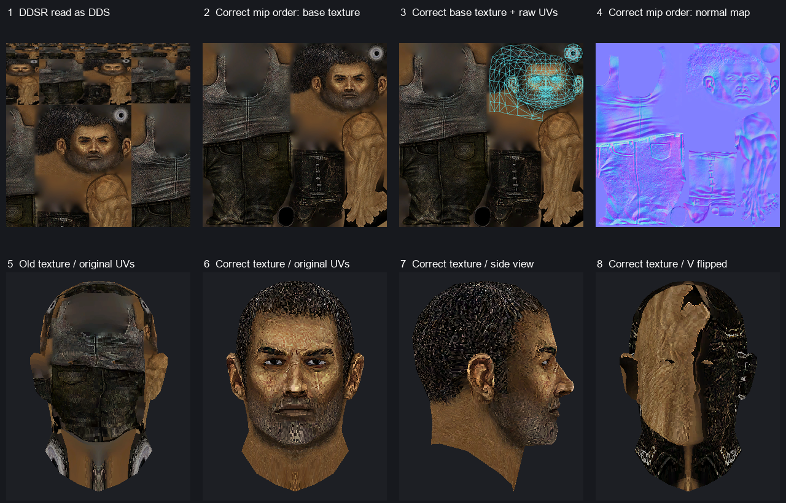
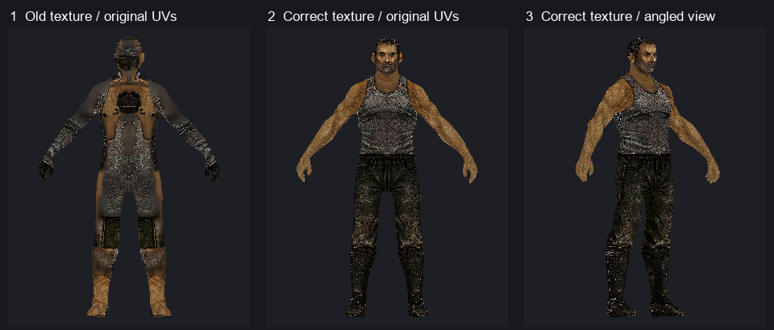

# R1 角色 UV 验证交接（2026-11-06）

**结论：保留 `hero_00.msh` 每个 76 字节顶点的 `+12/+16`（小端 `float32 U,V`），按贴图顶行 `V=0` 采样，不翻 V。** 旧窗口贴错的根因在贴图解码：`hero02.tex` 内的 `DDSR` 把 mip 层按小图到大图存放，旧脚本只改了魔数，普通 DDS 解码器遂从错误的位置读 512×512 主图。重排 mip 层后，**不改任何 UV**，头部和无护甲全身样本都正确贴图。原版引擎的顶点声明、贴图读取器和几何切线也分别支持这一结论。

## 实际画面对照



图 1 的错误图集与原 `hero02.png` 逐像素一致，上部混入重复的小尺寸图集，下部的主图错行。图 2 是只重排 mip 后的底色图集；图 3 叠加从文件直接读取的 UV，头颈三角形落在右上方的头部及眼睛区域。图 5、6 使用同一网格、同一组索引、同一组 UV 和同一相机，只切换底色图。图 6、7 的眼、嘴、耳和发际线与几何对齐；在正确底色图上强行用 `1-V`（图 8），则把手臂和衣服区域贴到脸上。图 4 是同法修正的法线图集；这轮软件渲染没有用它计算光照。



`hero_00.msh` 的单个几何块是头颈。全身复核样本是同档案里的 `Creatures/pc/hero_00_body_noarmor.msh`，引用同一张底色图，顶点仍为 76 字节、UV 仍在 `+12/+16`。只修正贴图后，背心、裸露手臂、裤子和靴子各自回到对应的几何区域。两张对照图均来自离线软件栅格化，使用绑定姿势、深度缓冲和底色采样。

## 交给 DeepSeek 的读取规则

下列偏移是**解档后的文件偏移**，十进制，区间右端不包含。头颈样本指 `.tooling/arc-extract/hero_00_game.msh`。

| 网格 | 顶点数据 | 三角形索引数据 |
| --- | --- | --- |
| `hero_00.msh` | `[141,174333)`，`2292 × 76` 字节 | `[174349,181657)`，`1218 × 3` 个 `u16`，共 7308 字节 |
| `hero_00_body_noarmor.msh` | `[141,417077)`，`5486 × 76` 字节 | `[417093,436665)`，`3262 × 3` 个 `u16` |

头颈的 tag 4 从 93 开始，`u32` 序列是 `4, 174232, 7, 76, 2292`，然后是 7 个 `u32` 语义 ID `0,4,1,6,5,2,3`，再跟顶点。tag 5 从 174333 开始，头是 `5, 7380, 1218, 1`，依次是 tag、payload 字节数、面数、面组数。索引后紧跟面组数据。旧 `hero.ib.bin` 多取了 12 字节，末尾两组 `(0,0,0)` 来自面组头；请把 `DrawIndexed` 的计数设为 **3654**，不是 3660。这个越界计数和贴图错位是两个独立问题。

| 顶点内偏移 | 语义 ID | 读取 |
| --- | ---: | --- |
| `+0` | 0 | `POSITION`，`float3` |
| `+12` | 4 | `TEXCOORD0`，`float2`，第二分量在 `+16` |
| `+20` | 1 | `NORMAL`，`float3` |
| `+32` | 6 | `BLENDINDICES`，4 个打包字节 |
| `+36` | 5 | `BLENDWEIGHT`，`float4` |
| `+52` | 2 | `TANGENT`，`float3` |
| `+64` | 3 | `BINORMAL`，`float3` |

`+32` 是骨骼索引。在头颈样本的 9168 个字节/权重对应项中，索引字节为 `0xFF` 当且仅当对应权重为 0；有权重的索引为 0–4。它们索引面组骨骼表 `[29,26,17,31,30]`，依次是 `Head`、`Neck`、`Spine1`、`R Clavicle`、`L Clavicle`（`Bip01` 前缀）；原版 `Engine.dll` 在 RVA `0xB92D8–0xB92E2` 用表项查全局骨骼数组。原版示例顶点着色器将 BGRA UNORM 输入 `.zyxw` 换序并乘约 255，得到与四个权重依序对应的文件字节。`hero_00.msh` 的材质从偏移 186925 引用 `Creatures/pc/hero02.tex`，从 186971 引用 `Creatures/pc/hero02_nml.tex`。

| 解档后的 `.tex` | DDSR 魔数 | 压缩数据起点 | 512×512 主图起点 | 主图字节数 |
| --- | ---: | ---: | ---: | ---: |
| `hero02.tex`，DXT1 / BC1 | 12 | 140 | 43844 | 131072 |
| `hero02_nml.tex`，DXT5 / BC3 | 12 | 140 | 87548 | 262144 |

两张图都有 10 层。`DDSR` 的磁盘顺序是 `1,2,4,8,16,32,64,128,256,512`（边长），标准 DDS 则先主图，再放逐级缩小的图。把 `.tex` 交给普通 DDS 工具之前，按块大小切出整层，反转**层的顺序**，每层内的字节保持原样；如果直接上传压缩子资源，把物理顺序第 `i` 段交给 mip `mipCount-1-i`。若已经走原版 `DDSR` 解码器，它会自行映射层，无需预先反转。块大小和标准顺序见 [Microsoft DDS 纹理布局](https://learn.microsoft.com/en-us/windows/win32/direct3ddds/dds-file-layout-for-textures)。

## 独立校验

- **原版顶点声明。** 本机 `x64/Engine.dll` 的 `GraphicsMesh::Initialize`（RVA `0xB3D70`）从 tag 4 调用 `0xB46B0`，在 `0xB4767–0xB477A` 逐项读语义 ID，`0xB47EB` 创建顶点声明。`x64/Direct3D11.dll` 的声明构造器（RVA `0x11400`，语义跳表 `0x11680`）把 ID 4 映射为 `TEXCOORD` 索引 0，类型为 `R32G32_FLOAT`，ID 6 映射为 `BLENDINDICES`。tag 5 的原版读取器（`Engine.dll` RVA `0xB4A20`）按 `3 × faceCount` 读取 `u16`。
- **原版 DDSR 读取。** `x64/Direct3D11.dll` 在 RVA `0x101AA–0x101E1` 识别 `DDSR`，在 `0x10423` 调用反序 mip 路径 `0x144F0`。该路径按 `max(1, width >> (mipCount-i-1))` 及对应高度算出第 `i` 段尺寸（`0x14551–0x145B8`），将段放到反序的子资源槽（`0x145D7–0x145FB`）。普通 DDS 路径 `0x143A0` 从最大尺寸开始。随游戏安装的 `TextureCompiler.exe` 也分两条写入路径，`DDSR` 分支（RVA `0x2E30`）跳过 `DDS ` 分支的描述符反转调用（`0x2E26`）。
- **原版解码器的逐像素对照。** 直接调用随游戏安装的 `TexViewer.exe` 中的 `DDSInfo` 和 `DDSBitmapCollection(..., reversed: true)`，两份原 `DDSR` 都解出 `512,256,…,1` 的链。它输出的两个 512×512 主图，各自与重排后由 Pillow 解码的 786432 个 RGB 字节完全一致。
- **原版着色器的采样。** `standardskinned.ssh` 内文件偏移 `0x2DDCC` 的 DXBC 顶点着色器直接传递 `TEXCOORD0.xy`（`mov o1.xy, v1.xyxx`）；`0x2EA84` 的像素着色器用 `v1.xy` 采样 `baseSampler` 和 `bumpSampler`，没有翻 V 或缩放 UV。
- **几何对 UV 的独立检验。** 对头颈的 1218 个三角形，用三角形位置差和 UV 差解 `∂P/∂U`、`∂P/∂V`。在全部 3654 个面角，`∂P/∂U` 与 `+52` 切线的点积为正（单位化后平均 `+0.9602`），`∂P/∂V` 与 `+64` 副切线的点积为负（平均 `−0.9490`）。这是存储的切线约定，不能据此翻贴图采样的 V。172 个负 UV 面积三角形中，516 个面角有 512 个的 `(N×T)·B` 为负，符合镜像 UV 岛；全身样本的 9786 个面角也全部符合两个导数方向。按位置焊接头颈顶点后，1809 条双面边中 1791 条的两侧 UV 端点相同，18 条是 UV 缝。原诊断对同一条边的不同端点作颜色差，不能用来判断接缝是否连续。

## 复现

在工作区根目录运行下列 Python（需要 Pillow）。它从原 `.tex` 重建 DDS，校验尺寸及块边界，输出到独立目录，不覆盖 DeepSeek 的文件。直接把产出的底色 PNG 接到 `.tooling/raster.py` 的 `tex` 输入，将 `IC` 改为 `3654`；该脚本原来的 `yaw=0` 会看到头后侧，`yaw=math.pi` 才看正脸。当前工作区也保留了生成两张对照图的 `.tooling/uv-validation-codex-20261106/check.py`，以及用于调用原版解码器的 `.tooling/uv-preview-agent-20261106/Export-OfficialMips.ps1`。

```python
from pathlib import Path
from struct import unpack_from
from PIL import Image

src = Path('.tooling/arc-extract')
out = Path('.tooling/uv-validation-codex-20261106')
out.mkdir(parents=True, exist_ok=True)

for name in ('hero02', 'hero02_nml'):
    tex = (src / f'{name}.tex').read_bytes()
    assert tex[:3] == b'TEX' and tex[12:16] == b'DDSR'
    assert unpack_from('<I', tex, 8)[0] == len(tex) - 12
    header = b'DDS ' + tex[16:140]
    h, w = unpack_from('<II', header, 12)
    mips = unpack_from('<I', header, 28)[0]
    block = {b'DXT1': 8, b'DXT5': 16}[header[84:88]]
    pos, levels = 140, []
    for mip in reversed(range(mips)):
        mw, mh = max(1, w >> mip), max(1, h >> mip)
        size = ((mw + 3) // 4) * ((mh + 3) // 4) * block
        levels.append(tex[pos:pos + size])
        pos += size
    assert pos == len(tex)
    dds = out / f'{name}-fixed.dds'
    dds.write_bytes(header + b''.join(reversed(levels)))
    with Image.open(dds) as image:
        image.save(out / f'{name}-fixed.png')
```

全身样本通过原有 `Extract.exe --stage9 Creatures/pc/hero_00_body_noarmor.msh <输出路径>` 从 `Creatures.arc` 提取，本次保存在 `.tooling/uvdata-agent-20261106/hero_00_body_noarmor.msh`。输入校验值（SHA-256）：

| 输入 | SHA-256 |
| --- | --- |
| `hero_00_game.msh` | `0e0d481c2cb90f6aa677ea02563a1f9cc0ec4290e821a343b5a01a6e7c87e2d3` |
| `hero_00_body_noarmor.msh` | `dce598c329c076812028d303b4524ba3d892f39cd16e072d9bc074625f171e5d` |
| `hero02.tex` | `ee8ed7215d319c9d918ccefea236d32807215446890a344283a81c2fe97e6ff9` |
| `hero02_nml.tex` | `b62e90afd125f493696d24db12478d5948043358145602b1a36049586c45276b` |
| `standardskinned.ssh` | `0dd319673ee42d39b08b4dd54e7d44176a762827dd5487fc840b92eaf6b6f19f` |
| `x64/Engine.dll` | `4c2ea14ce1c591b315cc29a8a96819a5c3c7e194adbd6f7eea208b9bb8a93153` |
| `x64/Direct3D11.dll` | `862a9ef1e67617c29122dc8b8b9c25dbbafe2e518ed98c0bb52b24b37d75ab5b` |
| `TexViewer.exe` | `7fe04649d7c2340e89f9b5a994742681b66ce644119e4e8ff98fc95414524934` |

本报告修正了 [UV 诊断](r1-uv-diag-20261106.json)、[模型缓冲区记录](r1-hero-buffers-20261106.json)及[资源提取记录](r1-hero-assets-extracted-20261106.json)中关于错位、索引数、`+32` 字段和 DDS 转换的判断。验证范围是本次两份网格的基础贴图 UV；原版 D3D11 出图、法线光照、蒙皮动画和装备组合仍需单独验证。
